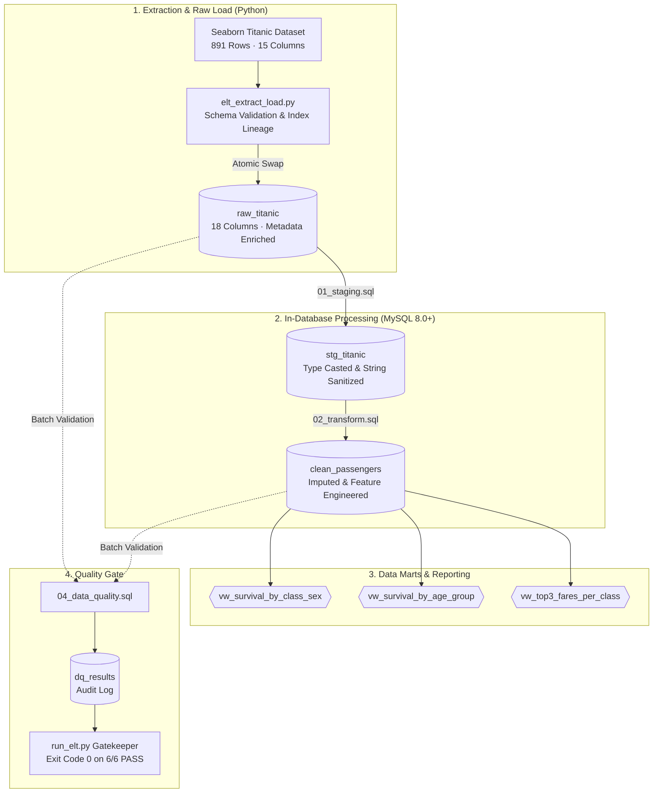

# Titanic ELT Pipeline

[](https://www.python.org/)
[](https://www.mysql.com/)
[](https://www.sqlalchemy.org/)
[](https://github.com/Vasanthkeerthan/Titanic-ELT-Pipeline)
[](docs/data-quality.md)
[](tests/)

An automated, production-grade **ELT (Extract, Load, Transform)** data pipeline built with **Python 3.10+**, **SQLAlchemy 2.0**, and **MySQL 8.0+**. The pipeline ingests source passenger records, executes atomic raw loading, performs complex in-database SQL cleaning and feature engineering using Common Table Expressions (CTEs) and Window Functions, enforces automated data-quality gates, and exposes structured analytical views.

---

## Table of Contents

- [Project Overview](#project-overview)
- [Key Features](#key-features)
- [Architecture & Data Flow](#architecture--data-flow)
- [Pipeline Layers & Technical Design](#pipeline-layers--technical-design)
  - [1. Extract & Raw Load (Python)](#1-extract--raw-load-python)
  - [2. Staging Layer (SQL)](#2-staging-layer-sql)
  - [3. Transformation & Feature Engineering (SQL)](#3-transformation--feature-engineering-sql)
  - [4. Analytics Layer (SQL Views)](#4-analytics-layer-sql-views)
  - [5. Data Quality Validation (SQL & Python Gate)](#5-data-quality-validation-sql--python-gate)
- [Data Quality Assurance](#data-quality-assurance)
- [Verified Execution Results](#verified-execution-results)
- [Project Structure](#project-structure)
- [Getting Started](#getting-started)
  - [Prerequisites](#prerequisites)
  - [Installation & Setup](#installation--setup)
  - [Environment Configuration](#environment-configuration)
  - [Running the Pipeline](#running-the-pipeline)
  - [Running Automated Unit Tests](#running-automated-unit-tests)
- [Verification & Inspection SQL](#verification--inspection-sql)
- [Operational Considerations](#operational-considerations)
- [Future Roadmap](#future-roadmap)

---

## Project Overview

Traditional ETL workflows often transform data in memory before writing to storage. This project follows modern **ELT principles**, leveraging the database engine's computational power to execute transformations, statistical imputations, and feature engineering directly in SQL.

Designed as an end-to-end data engineering portfolio project, it highlights:
- **Resilient Ingestion:** Schema verification, record lineage tracking, and atomic table swaps to avoid staging corruption.
- **In-Database Transformations:** Multi-pass SQL transformations utilizing CTEs, `PARTITION BY` window functions, and `NTILE` bucketing.
- **Data Quality as Code:** Run-scoped data quality checks stored directly in MySQL that halt pipeline execution if assertions fail.
- **Dimensional Analytics:** Production-ready views prepared for business intelligence and reporting.

---

## Key Features

- **Atomic Staging Pattern:** Loads raw data into a unique batch-scoped staging table and performs an atomic table swap (`RENAME TABLE`), preventing half-loaded states during pipeline runs.
- **Preserved Record Lineage:** Automatically assigns and propagates a persistent `source_row_id` alongside metadata (`load_timestamp`, `batch_id`) across all layers.
- **Statistical In-Database Imputation:** Calculates subgroup means (`PARTITION BY passenger_class, sex`) with overall mean fallback for missing ages, and modal imputation for missing embarkation ports.
- **Feature Engineering in SQL:**
  - `age_group`: Categorization into `Child`, `Teen`, `Adult`, and `Senior`.
  - `family_size` & `is_alone`: Derived from family co-passenger tallies.
  - `fare_category`: Population quartile segmentation (`Low`, `Medium`, `High`, `Premium`) via `NTILE(4)`.
  - `sex`: Binary integer encoding (`0` for male, `1` for female).
- **Run-Scoped Quality Gate:** Six automated database assertions per batch. If any check fails, `run_elt.py` logs the failure and exits with a non-zero code.
- **Comprehensive Unit Testing:** Python test suite verifying statement parsers, comment handling, and validation reporting.

---

## Architecture & Data Flow



---

## Pipeline Layers & Technical Design

### 1. Extract & Raw Load (Python)
- **Module:** [`elt_extract_load.py`](elt_extract_load.py)
- **Source:** Seaborn Titanic dataset (891 passenger observations, 15 attributes).
- **Lineage & Validation:**
  - Strictly asserts that the incoming dataset matches expected columns and row count (891 rows).
  - Preserves the source index as `source_row_id` for end-to-end lineage tracking.
  - Appends operational audit fields: `batch_id` (UUID4) and UTC `load_timestamp`.
- **Atomic Swap Strategy:** Data is written to `raw_titanic_load_<uuid>` via SQLAlchemy. Once verified, MySQL executes an atomic `RENAME TABLE` to replace `raw_titanic` without pipeline downtime.

### 2. Staging Layer (SQL)
- **Script:** [`sql/01_staging.sql`](sql/01_staging.sql)
- **Table:** `stg_titanic`
- **Responsibilities:**
  - Casts numeric and indicator fields to explicit types (`UNSIGNED`, `DECIMAL(5, 2)`, `DECIMAL(10, 4)`).
  - Sanitizes and standardizes textual columns with `LOWER(TRIM(...))`.
  - Renames ambiguous columns into self-documenting identifiers (e.g., `sibsp` &rarr; `siblings_spouses_aboard`, `parch` &rarr; `parents_children_aboard`, `alone` &rarr; `source_is_alone`).

### 3. Transformation & Feature Engineering (SQL)
- **Script:** [`sql/02_transform.sql`](sql/02_transform.sql)
- **Table:** `clean_passengers`
- **Transformation Logic:**
  - **Age Imputation:** Computed using CTEs and window functions:
    ```sql
    AVG(age) OVER (PARTITION BY passenger_class, sex) AS class_sex_average_age
    ```
    Missing values coalesce to class-sex averages, falling back to the overall population mean.
  - **Port Imputation:** Missing embarkation records are imputed using a subquery identifying the mode (`'s'` for Southampton).
  - **Categorical Binning:**
    - `age_group`: `<13` (Child), `13–19` (Teen), `20–59` (Adult), `60+` (Senior).
    - `fare_category`: 4 tiers derived via `NTILE(4) OVER (ORDER BY fare ASC, ...)`.
  - **Feature Derivations:**
    - `family_size = siblings_spouses_aboard + parents_children_aboard + 1`
    - `is_alone = CASE WHEN family_size = 1 THEN 1 ELSE 0 END`
    - `sex`: Binary flag (`0` for male, `1` for female).

### 4. Analytics Layer (SQL Views)
- **Script:** [`sql/03_analytics.sql`](sql/03_analytics.sql)
- **Views Created:**
  1. `vw_survival_by_class_sex`: Aggregates passenger count, survivors, and survival percentage grouped by ticket class and sex.
  2. `vw_survival_by_age_group`: Summarizes total passengers, survival count, and survival rates across defined age brackets.
  3. `vw_top3_fares_per_class`: Identifies highest-paying passenger profiles per class using `RANK() OVER (PARTITION BY passenger_class ORDER BY fare DESC)`.

### 5. Data Quality Validation (SQL & Python Gate)
- **Script:** [`sql/04_data_quality.sql`](sql/04_data_quality.sql)
- **Orchestration:** [`run_elt.py`](run_elt.py)
- **Audit Table:** `dq_results`
- Enforces strict criteria at run-time. The runner reads check results scoped by `batch_id` and terminates with exit code `1` if any check reports `FAIL`.

---

## Data Quality Assurance

The pipeline executes six automated assertions against each batch:

| Check Name | Target Layer | Validation Objective | Threshold |
|---|---|---|---|
| `raw_count_equals_clean_count` | `raw_titanic` vs. `clean_passengers` | Ensures 1:1 row parity throughout the pipeline without accidental drops or row-multiplication. | `raw_count = clean_count = 891` |
| `no_null_age` | `clean_passengers` | Verifies that window-function statistical age imputation eliminated all NULLs. | 0 NULLs |
| `no_null_embarked` | `clean_passengers` | Confirms modal embarkation imputation resolved all unrecorded boarding ports. | 0 NULLs |
| `no_duplicate_passengers` | `raw_titanic` & `clean_passengers` | Validates that source-record lineage (`source_row_id`) is strictly unique and uncompromised. | Exactly 1 occurrence per row ID |
| `age_between_0_and_100` | `clean_passengers` | Domain integrity check ensuring no imputed or extracted age falls outside human biological limits. | `0 <= age <= 100` |
| `sex_encoded_only_0_or_1` | `clean_passengers` | Guarantees categorical transformation produced only valid binary flags (`0` or `1`). | Exclusively `0` or `1` |

> [!NOTE]
> **Lineage vs. Duplicate Profiles:** The source Seaborn dataset lacks unique passenger business keys (such as passport or ticket IDs). Consequently, 53 combinations of passenger attributes appear more than once (e.g., third-class adult males with identical fares and embarkation points). Rather than erroneously dropping potential real passengers, the pipeline preserves source integrity using `source_row_id` as the record lineage key. Detailed lineage analysis is documented in [`docs/data-quality.md`](docs/data-quality.md).

---

## Verified Execution Results

The pipeline has been executed and verified in the local environment.

### 1. Pipeline Execution Output
```text
Starting Titanic ELT pipeline (batch 4f464e44-b74f-4b5e-aca7-ac08b82efc3e)
Loaded 891 original rows and 18 columns into 'raw_titanic' (batch 4f464e44-b74f-4b5e-aca7-ac08b82efc3e).
Executed sql\01_staging.sql
Executed sql\02_transform.sql
Executed sql\03_analytics.sql
Executed sql\04_data_quality.sql
[PASS] raw_count_equals_clean_count
[PASS] no_null_age
[PASS] no_null_embarked
[PASS] no_duplicate_passengers
[PASS] age_between_0_and_100
[PASS] sex_encoded_only_0_or_1
ELT pipeline completed successfully.
```

### 2. Table Count Verification
| Layer | Table Name | Row Count | Status |
|---|---|---:|:---:|
| Raw | `raw_titanic` | 891 | Verified |
| Staging | `stg_titanic` | 891 | Verified |
| Clean | `clean_passengers` | 891 | Verified |

### 3. Verified Analytics Mart Metrics

#### Survival by Passenger Class & Sex (`vw_survival_by_class_sex`)
| Passenger Class | Sex (`0`=M, `1`=F) | Total Passengers | Survivors | Survival Rate (%) |
|:---:|:---:|---:|---:|---:|
| 1st | Male (`0`) | 122 | 45 | **36.89%** |
| 1st | Female (`1`) | 94 | 91 | **96.81%** |
| 2nd | Male (`0`) | 108 | 17 | **15.74%** |
| 2nd | Female (`1`) | 76 | 70 | **92.11%** |
| 3rd | Male (`0`) | 347 | 47 | **13.54%** |
| 3rd | Female (`1`) | 144 | 72 | **50.00%** |

#### Survival by Age Bracket (`vw_survival_by_age_group`)
| Age Group | Total Passengers | Survivors | Survival Rate (%) |
|---|---:|---:|---:|
| **Child** (< 13 yrs) | 69 | 40 | **57.97%** |
| **Teen** (13–19 yrs) | 95 | 39 | **41.05%** |
| **Adult** (20–59 yrs) | 701 | 256 | **36.52%** |
| **Senior** (60+ yrs) | 26 | 7 | **26.92%** |

### 4. Automated Unit Suite
```text
Ran 5 tests in 0.000s

OK
```
All 5 unit tests in [`tests/test_run_elt.py`](tests/test_run_elt.py) passed, validating SQL statement segmentation, comment parsing, and data-quality reporting logic.

---

## Project Structure

```text
Titanic-ELT-Pipeline/
├── sql/
│   ├── 01_staging.sql          # Type casting, text normalization & renaming
│   ├── 02_transform.sql        # Imputation, feature engineering & categorical binning
│   ├── 03_analytics.sql        # Analytical views (class/sex, age groups, top fares)
│   └── 04_data_quality.sql     # Run-scoped audit checks and status logging
├── docs/
│   └── data-quality.md         # Comprehensive quality rules & schema audit queries
├── tests/
│   └── test_run_elt.py         # Unit tests for runner parsing & check evaluation
├── .env.example                # Template for database credentials
├── .gitignore                  # Git exclusion rules (virtual environments, credentials)
├── config.py                   # Environment loading & MySQL connection factory
├── elt_extract_load.py         # Source dataset extraction & atomic raw load logic
├── requirements.txt            # Python runtime dependencies
├── run_elt.py                  # Pipeline orchestrator and quality gate runner
└── README.md                   # Project documentation
```

---

## Getting Started

### Prerequisites

- **Python:** Version `3.10` or higher
- **MySQL Server:** Version `8.0` or higher (required for Window Functions and CTE support)
- **Network Connection:** Required on initial run to retrieve the source dataset via Seaborn

### Installation & Setup

1. **Clone the repository:**
   ```bash
   git clone https://github.com/Vasanthkeerthan/Titanic-ELT-Pipeline.git
   cd Titanic-ELT-Pipeline
   ```

2. **Create and activate a virtual environment:**
   - **Windows (PowerShell):**
     ```powershell
     python -m venv .venv
     .\.venv\Scripts\Activate.ps1
     ```
   - **Linux / macOS:**
     ```bash
     python3 -m venv .venv
     source .venv/bin/activate
     ```

3. **Install dependencies:**
   ```bash
   python -m pip install --upgrade pip
   python -m pip install -r requirements.txt
   ```

### Environment Configuration

Create a `.env` file in the project root based on [`.env.example`](.env.example):

- **PowerShell:**
  ```powershell
  Copy-Item .env.example .env
  ```
- **Bash:**
  ```bash
  cp .env.example .env
  ```

Update `.env` with your MySQL connection credentials:

```dotenv
DB_HOST=localhost
DB_USER=your_mysql_username
DB_PASSWORD=your_mysql_password
DB_NAME=titanic_db
```

> [!IMPORTANT]
> The target database (`DB_NAME`) will be automatically created if it does not already exist, provided your MySQL user account has `CREATE DATABASE` privileges. Never commit `.env` to source control.

### Running the Pipeline

Execute the orchestrator:

```powershell
python run_elt.py
```

The runner:
1. Generates a unique UUID4 `batch_id`.
2. Downloads and validates the source dataset.
3. Performs an atomic load into `raw_titanic`.
4. Executes `01_staging.sql`, `02_transform.sql`, `03_analytics.sql`, and `04_data_quality.sql`.
5. Evaluates the quality gate and prints the status of each check.

### Running Automated Unit Tests

Run the test suite using Python's built-in `unittest` runner:

```powershell
python -m unittest discover tests
```

---

## Verification & Inspection SQL

Connect to your MySQL database via MySQL Workbench, DBeaver, or the CLI (`mysql -u <user> -p titanic_db`) and run the following queries:

### 1. Verify Pipeline Row Counts
```sql
SELECT
    (SELECT COUNT(*) FROM raw_titanic) AS raw_rows,
    (SELECT COUNT(*) FROM stg_titanic) AS staging_rows,
    (SELECT COUNT(*) FROM clean_passengers) AS clean_rows;
```

### 2. Inspect Latest Data Quality Results
```sql
SELECT check_name, status, checked_at
FROM dq_results
ORDER BY checked_at DESC
LIMIT 6;
```

### 3. Verify Age & Embarkation Imputation (NULL Check)
```sql
SELECT
    COUNT(*) AS total_rows,
    SUM(CASE WHEN age IS NULL THEN 1 ELSE 0 END) AS null_ages,
    SUM(CASE WHEN embarked IS NULL THEN 1 ELSE 0 END) AS null_embarked
FROM clean_passengers;
```

### 4. Query Analytics Views
```sql
-- Survival breakdown by ticket class and sex
SELECT passenger_class, sex, total_passengers, number_survived, survival_rate_percent
FROM vw_survival_by_class_sex
ORDER BY passenger_class, sex;

-- Survival distribution across age categories
SELECT age_group, total_passengers, number_survived, survival_rate_percent
FROM vw_survival_by_age_group
ORDER BY survival_rate_percent DESC;

-- Highest fares per passenger class
SELECT passenger_class, fare, survived, sex, fare_rank
FROM vw_top3_fares_per_class
ORDER BY passenger_class, fare_rank;
```

---

## Operational Considerations

- **MySQL Privileges:** The configured database user requires `CREATE`, `DROP`, `RENAME`, `SELECT`, `INSERT`, and `ALTER` privileges on `DB_NAME`.
- **Idempotency & Re-runnability:** The pipeline can be rerun at any time without duplicate key conflicts. Each run atomically updates the target tables and records a new run audit batch in `dq_results`.
- **Atomic Swap Safeguard:** If an error occurs during raw loading, the staging table is automatically cleaned up and the previous snapshot of `raw_titanic` remains intact.

---

## Future Roadmap

- [ ] **Workflow Orchestration:** Integrate Apache Airflow or Dagster for DAG scheduling, retry policies, and operational alerting.
- [ ] **Containerization:** Provide a `docker-compose.yml` bundling MySQL and the ELT execution container for one-command deployment.
- [ ] **dbt Integration:** Migrate the transformation SQL scripts into a dbt project for automated lineage graphs and documentation hosting.
- [ ] **CI/CD Automation:** Set up GitHub Actions to execute unit tests and SQL linting (`sqlfluff`) on pull requests.
