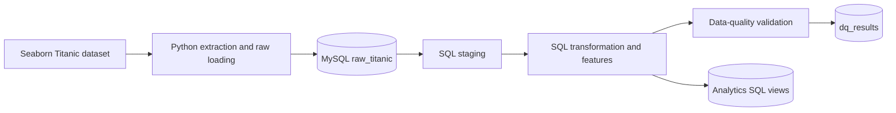
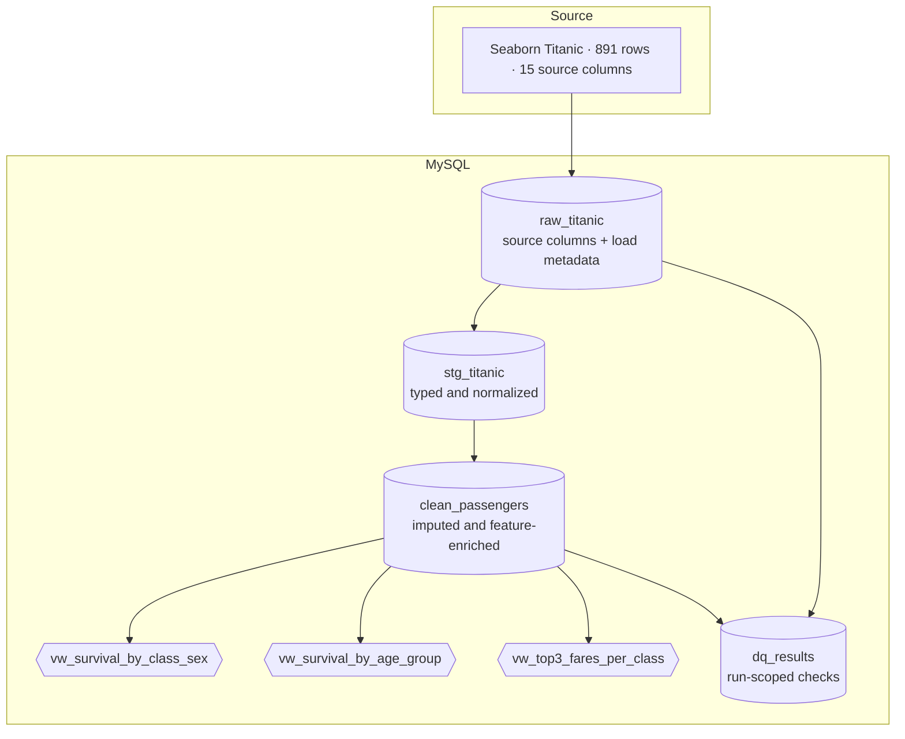

# Titanic ELT Pipeline

[](https://www.python.org/)
[](https://www.mysql.com/)
[](https://pandas.pydata.org/)
[](https://seaborn.pydata.org/)

A reproducible, SQL-first ELT exercise using Seaborn's Titanic dataset and MySQL. Python extracts and loads the source; MySQL handles staging, cleaning, feature engineering, analytics, and data-quality checks. The raw source is kept separate from the independent ELT models.

> **Scope:** This project does not modify the completed ETL project or its `passengers` table. Analytics are exposed as SQL views, not a materialized final table.

## Contents

- [ELT approach and architecture](#elt-approach-and-architecture)
- [Data layers and transformations](#data-layers-and-transformations)
- [Requirements and setup](#requirements-and-setup)
- [Run the pipeline](#run-the-pipeline)
- [Verify results](#verify-results)
- [Project structure](#project-structure)
- [Troubleshooting and limitations](#troubleshooting-and-limitations)

## ELT approach and architecture

Traditional **ETL** transforms data before loading it to its destination. **ELT** loads source data first, then uses the destination's SQL engine to transform it. This project uses ELT to keep an inspectable raw snapshot and perform modeling close to the MySQL analytics layer.





## Data layers and transformations

| Layer | Object | Purpose |
|---|---|---|
| Raw | `raw_titanic` | 15 original Seaborn columns plus `load_timestamp` and `batch_id`. Python checks the expected 891 rows and 17 columns before replacing the prior snapshot. |
| Staging | `stg_titanic` | SQL casts fields to numeric types, normalizes selected text with `LOWER(TRIM(...))`, and carries load metadata. |
| Clean | `clean_passengers` | SQL imputes missing age by class and sex (overall mean fallback), imputes missing embarkation with the most frequent port, encodes sex, and derives age group, family size, alone flag, and fare category. |
| Analytics | `vw_survival_by_class_sex`, `vw_survival_by_age_group`, `vw_top3_fares_per_class` | SQL views summarize survival and rank fares. The top-fares view uses `RANK()`, so ties may return more than three rows per class. |
| Quality | `dq_results` | Stores six run-scoped `PASS`/`FAIL` checks with batch ID and timestamp. A failed or missing check makes the runner exit nonzero. |

The raw table is refreshed from the complete source on each run; it is not appended. A UUID-named temporary load table is checked and atomically renamed into place. Cleaning and feature engineering happen in MySQL, not Python. Source NULLs are not imputed before loading.

### Transformation rules

- Missing age: mean for `(passenger_class, sex)`, falling back to overall mean.
- Missing `embarked`: most frequent non-NULL value; ties resolve alphabetically.
- `sex`: male = `0`, female = `1`.
- Age groups: Child `<13`, Teen `13–19`, Adult `20–59`, Senior `60+`.
- `family_size = siblings_spouses_aboard + parents_children_aboard + 1`; `is_alone` is 1 when family size is 1.
- Fare category uses `NTILE(4)` ordered by fare and source fields. Exact ties at a quartile boundary can land in adjacent bands.

## Requirements and setup

- Python 3.10 or later
- MySQL 8.0 or later (the SQL uses common table expressions and window functions)
- Network access on the first run to load the Seaborn sample dataset
- A MySQL account that can create a database (if absent), create/drop/rename tables and views, and write to `dq_results`

From PowerShell in the project directory:

```powershell
py -3 -m venv .venv
.\.venv\Scripts\Activate.ps1
python -m pip install --upgrade pip
python -m pip install -r requirements.txt
Copy-Item .env.example .env
```

Edit `.env` locally:

```dotenv
DB_HOST=localhost
DB_USER=your_mysql_username
DB_PASSWORD=your_mysql_password
DB_NAME=titanic_db
```

`.env` is ignored by Git. Never commit real credentials. The connector uses the configured host and credentials; TLS is not configured by this local-development setup.

## Run the pipeline

```powershell
python .\run_elt.py
```

The runner creates a UUID batch, loads the raw snapshot, then executes `sql/01_staging.sql` through `sql/04_data_quality.sql` in that order. It prints each check as `[PASS]` or `[FAIL]`; a failed check or pipeline error returns a nonzero exit code.

## Verify results

Run these examples in MySQL Workbench or another MySQL client after a successful pipeline run:

```sql
SHOW TABLES;

SELECT COUNT(*) AS raw_rows FROM raw_titanic;
SELECT COUNT(*) AS staging_rows FROM stg_titanic;
SELECT COUNT(*) AS clean_rows FROM clean_passengers;

SELECT passenger_class, sex, total_passengers, number_survived,
       survival_rate_percent
FROM vw_survival_by_class_sex
ORDER BY passenger_class, sex;

SELECT age_group, total_passengers, number_survived, survival_rate_percent
FROM vw_survival_by_age_group
ORDER BY age_group;

SELECT check_name, status, checked_at
FROM dq_results
ORDER BY checked_at DESC
LIMIT 6;
```

The analytics queries return the displayed columns; row values depend on the loaded dataset and are intentionally not presented as pre-verified sample output. More row-count, NULL, duplicate-profile, schema, and raw-to-clean checks are in [`docs/data-quality.md`](docs/data-quality.md).

Example result shape for `vw_survival_by_class_sex` (the row below is a placeholder, not a measured result):

| passenger_class | sex | total_passengers | number_survived | survival_rate_percent |
|---|---|---:|---:|---:|
| … | … | … | … | … |

## Project structure

```text
.
├── config.py                 # Environment-based MySQL connection
├── elt_extract_load.py       # Source extraction and atomic raw refresh
├── run_elt.py                # Ordered SQL execution and check reporting
├── sql/
│   ├── 01_staging.sql
│   ├── 02_transform.sql
│   ├── 03_analytics.sql
│   └── 04_data_quality.sql
├── docs/
│   └── data-quality.md       # Check definitions and verification SQL
├── tests/
│   └── test_run_elt.py       # Unit tests for SQL splitting and check reporting
├── .env.example
├── .gitignore
└── requirements.txt
```

## Troubleshooting and limitations

- **Missing MySQL settings:** create `.env` from `.env.example` and fill in all four values.
- **Connection refused:** start MySQL and verify `DB_HOST`; credentials are not printed by the runner.
- **Access denied / database creation error:** grant the configured account the required database and table permissions, or create `DB_NAME` before running.
- **Dataset download or schema error:** check network access. The loader refuses to proceed if the downloaded source does not match the expected 15 columns and 891 rows.
- **Data-quality failure:** inspect the run's `dq_results` rows using its batch ID. A duplicate check groups by all 15 source fields and is a duplicate-*profile* check, not proof of passenger identity. The source has no unique passenger ID, so identical profiles may represent distinct people; records are preserved and not deduplicated.
- **Raw refresh failure:** the prior raw table is left in place until the checked temporary table is ready for atomic rename.

The repository currently has no captured database execution screenshots or live MySQL results. The automated tests cover Python helper behavior; they do not replace running the pipeline against a configured MySQL server.
